# Home cooking robot — project summary

## 概要
目标：一台家用机器人，能照着家常菜谱把菜真正做出来。参考的是一位做家常四菜一汤的博主，王刚的菜谱作为更大范围的核对。

**做法**
- **方案**：一辆带电源线的小车停靠在灶台前，车上装一台 UR5e 机械臂。
- **手**：DH PGC-140-50 夹爪，配可更换的 3D 打印手指。
- **炒锅**：凹面电磁炉加带键块的炒锅，机械臂拿锅铲翻炒，端锅把菜倒进盘里。
- **其他**：第二个电磁炉配锅、电炖锅、调料站、冰箱取料盒。

**状态**
- 所有动作都在 MuJoCo 仿真里一步一步做过碰撞检查，力都有来源，没有为了"通过"去调参数。
- 三顿参考饭的仿真时长：A 39.5 分钟，B 75.6 分钟，C 38.6 分钟。
- 还没有买任何东西，也没有用真实食材测过。
- **R19（10-13）**：探索省钱和动作平滑。
  - 提出"预先检查好的动作组 + 固定枢纽姿态"的动作库；枢纽之间的 22 条空手路径已全部检查通过。
  - 5 个已检查动作改成平滑轨迹并重新检查，端锅停顿从 470 次降到 7 次。
  - 正在仿真验证便宜的国产臂（法奥 FR5）。
  - 备菜是最大缺口，正在按参考视频里"买回来的状态"重新统计。

## Goal
The end goal is a home robot that actually cooks recipes end to end (user: "最终目标就是按王刚食谱做菜真的能做出来"). Since R16 the main reference is a home-style creator's 四菜一汤 meals: 4 dishes + 1 soup + rice for a family (`research/homestyle_meals.md`). Wang Gang's recipes stay as a wider check (`research/wanggang_recipes.md`, `research/wanggang_cooking.md`).

The robot cooks and plates. The user serves and clears the finished plates.

## Current design (as of R18, 2026-10-12)
All sizes are estimates unless stated. Nothing has been bought.

| Part | Choice | Where it was decided / checked |
|---|---|---|
| Base | **Tethered floor cart**, docked against the base-cabinet fronts. About 63–67 kg, no ballast, no battery, mains via cable, controller off-board. Two ZLTECH drive wheels and two casters. Moves along the counter, x −1.48 … 1.46 m in the sim. It may move while the arm holds things out over the counter, if every step is collision checked. | R09 concept, R10 design, user decision 10-12 |
| Arm | One **UR5e** at 1.12 m, tilted 20° toward the counter, hung from a cantilever beam. | R10 |
| Hand | **DH PGC-140-50** (IP67, 50 mm stroke, 7 N·m jaw moment limit). Robot-swappable **3D-printed finger sets** P1–P7: dual-zone pads (rigid rims plus a sprung soft centre) and a finger-root force sensor. | R12, R13 (accepted) |
| Groceries | The user puts groceries into the robot's slot trays and baskets. Grasps: pinch, supported fork (托底叉), side-handle basket pour, in-the-box. | R13 (accepted) |
| Prep | Appliances do the precise cutting; the arm loads, unloads and pulls levers. A 3-in-1 slicer (top chute) on the counter, a lever cutter base with plates, a peeler station, sink washing. Light tools are fetched from storage and put back. | R07–R11 |
| Seasonings | A station in the upper cabinet: 12 peristaltic channels, 4 powder augers, 2 paste syringes, a 花椒 feeder. Every dose is weighed into robot cups at about 1.10–1.15 m. A rotary 4-compartment **pour drum** at the wok swings away except while stirring. | R14, R17 |
| Staples | **The user loads and starts the rice cooker** (decision 10-13); the rice hopper is dropped. Flour/starch hopper, fryer. | R14, R19 |
| Ingredients in | As the reference cook buys them in his videos: ribs chopped by the butcher, fish and squid cleaned by the fishmonger. Everything he does himself is the robot's job. | user decision 10-13 |
| Fridge | The user's single-door fridge. The arm opens it to 35° by the handle in one motion, and takes a cold box (冷藏料盒) from a door bin. Nothing is taken from the shelves. | R14 (accepted) |
| Wok | **Concave 3.5 kW induction cooker** (knob turned by a servo; 离火 = power 0) with a 34 cm carbon-steel wok. Short handle with a keyed grip block; a keyed slot in the cooker rim. Thermal and colour cameras under the hood. | R15, R17 |
| Stir-fry | The arm holds a 0.45 m spatula. Stroke: scrape, lift, return through the air, **2.63 s per stroke**. R19 found this is not executable as checked: the speed jumps where each working part ends. It needs a re-run, at about 3.6 s per stroke if it stops there. The arm stays out of the steam plume. Batches of about 200 g or less until real food is tested. | R15, re-checked in R18; R19 |
| Plating | The arm lifts the wok and tips it to 90° toward itself over a guarded plate. **Two plating spots** (x 0.43 and 0.17). | R15, R18 |
| Wok rinse | At the sink. The arm first pushes the user's single-lever faucet open (clip-on block) and leaves it running, plates, rinses the wok under the tap, sets it back, then closes the faucet. | user decision, R17 |
| Water | No pipe or valve. Water comes in containers the user fills: the kettle, a jug, the steaming water. | user decision |
| Second zone | Flat MIoT induction with a 30 × 12 cm pot and a 4 cm steaming rack. Lid with a front tab on a rack. Steamer dish carrier with a bail. Spider strainer on a rest at (1.52, 0.36). | R16, R17 |
| Soups | Electric stew pot. The user serves from the pot (no ladle). | user decision |
| Spatula | Lies flat on the counter **left of the sink** at (−1.15, 0.30), flipped over compared with the R16 rest. | R18b (user's suggestion) |
| Safety (home tier) | Collaborative arm (power and force limiting), speed limits, presence sensing, E-stop, RCD/PE, brakes on gravity-loaded axes; guarded blades. No industrial scanners or safety PLC. | DECISIONS 10-07 |

## What is verified in simulation
**Checking rules:**
- Every action is a whole continuous path, every state checked. Gaps: 10 mm robot↔environment, 5 mm gripper or held object↔environment.
- Contact windows are only at grasp and release.
- Process forces come from sources and are never tuned.
- Grasps pass a physics gate (MuJoCo noslip, wet μ).

| Action | Result | Evidence |
|---|---|---|
| Carrot prep chain (tray → wash → peel → slicer chute) | closed, 7,431 states, about 28 s, physics gate passes | README_R10 R11/R12, `results/chain_SD` |
| Tomato chain (pick → rinse → lever cutter) | closed, 5,992 states, about 22 s, about 5 N per finger | R12, `results/chain_WD` |
| Food bench (about 40 foods, 702 rigid + 53 non-rigid runs) | grasp method per food | R13, `results/r13*` |
| Seasoning port, drum, rice port reach | pass at z 1.05–1.20 | R14, `results/r14` |
| Fridge door 0–35° and cold box | pass | R14 |
| Stir cycle, 5 strokes | 2.63 s per stroke, reserve ≥ 2.0 mm, plume ≥ 25.8 mm; re-run in the current kitchen in R18 | R15, `results/r15/stirwalk2_h_scrape_dice_r17.json` |
| Wok plate + sink rinse + back | 48.9 s, PGC 6.47 of 7 N·m | R17, `results/r17/chain_wok_s-1_final.json` |
| Same, at the second plating spot with a dish on the first | passes, 48.9 s | R18 |
| Faucet lever open / close | 3.5 s | R17 |
| Lid off → rack | 20.2 s | R17 |
| Spider pot → plate → rest | 52.6 s | R17 |
| Dish carrier into the pot | 17.7 s | R16/R17 |
| Spatula rest → stroke start → R15 stir | 26.9 s + 0.5 s hand-off | R18b |
| Plating physics (rigid dice) | 81–91 % on the plate (98 % at half load) | R15 |
| Hub roadmap of free moves (4 cart stations, one tucked posture) | all 22 edges and all 42 routes between the 7 action endpoints pass | R19, `results/r19/hub/graph.json` |
| Smoothed paths (B-splines, jerk-limited) of wok, spatula, lid, spider, lever | re-checked at ≤ 4 mm, 0 hits; wok stops 470 → 7 | R19, `R19_SMOOTH.md` |

**Meal timing** (`sim/r10/claude/meal16.py SET=stew ARM=r18`). The checked action times are combined with estimated free moves:

| Meal | Total | Arm busy |
|---|---|---|
| A | 39.5 min | 16.9 min |
| B | 75.6 min | 31.4 min |
| C | 38.6 min | 20.9 min |

With the user loading the rice cooker (`USERRICE=1`): A 38.2 / B 75.6 / C 35.6 min, arm busy 13.9 / 28.4 / 17.9 min. **Prep is not in these numbers.** The R19 audit estimates 21–40 more arm minutes per meal for prep, before the as-bought recount.

**Build Day demo video (2:30):** [docs/claude_cooks_build_day.mp4](docs/claude_cooks_build_day.mp4). It shows Claude Opus 5.5 cooking 西红柿炒蛋 in real time with predefined routines, and every robot motion is a checked path.

## Motion clips

Clips are cropped from `sim/r10/claude/renders` (plus two Mac renders of stored R14/R18b paths) and re-captioned in English; speed factors are noted. Made by `make_gifs.py` in the Build Day demo layer (not in this repo yet).

### Arm motions in the kitchen

The UR5e on its cart running a stored path; every state was checked (10 mm robot, 5 mm gripper/held object).

| | |
|---|---|
| 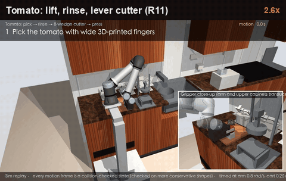 **Tomato: lift, rinse, lever cutter (R11)** 6,653 checked states. Starts with the tomato gripped; water and cutting not simulated. 2.6× | 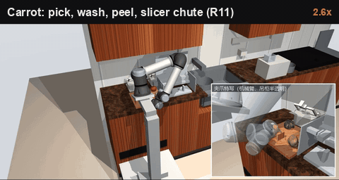 **Carrot: pick, wash, peel, slicer chute (R11)** 7,431 checked states; the cart drives between stations. 2.6× |
| 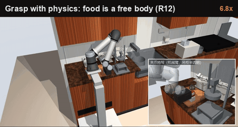 **Same chain with grasp physics (R12)** Food is a free body, never welded; slip measured. 6.8× | 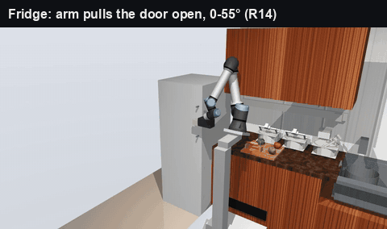 **Fridge: arm pulls the door open, 0–55° (R14)** 23 door angles on one IK branch, 0.1–4.2 mm reserve. Keyframes. |
| 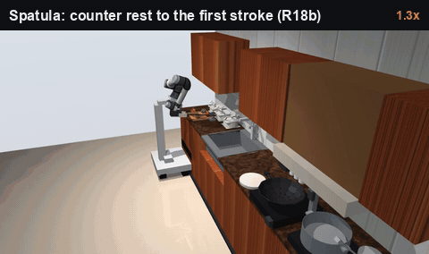 **Spatula: counter rest to the first stroke (R18b)** 26.9 s, one continuous checked path, 6.0 mm reserve. 1.3× | 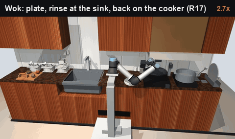 **Wok: plate, rinse at the sink, back (R17)** One continuous path, 48.9 s, 2.0 mm min clearance (R19 re-check). 2.7× |
| 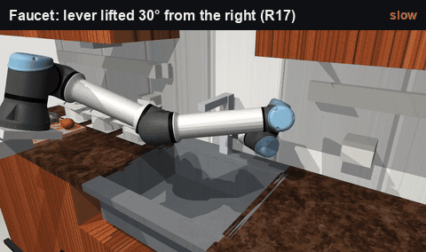 **Faucet lever lifted 30° (R17)** 3.5 s; clip-on block on the single-lever faucet. Slowed 3×. | 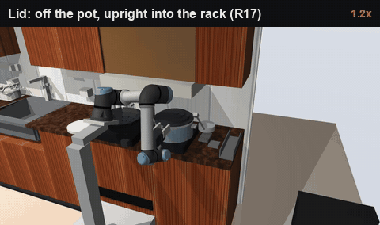 **Lid off the pot, upright into the rack (R17)** 20.2 s, 1.0 mm clearance: needs a keyed tab (#8). 1.2× |
| 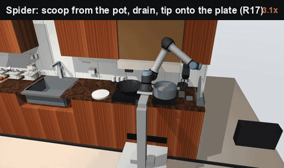 **Spider: scoop, drain, tip onto the plate (R17)** 52.6 s, 2.1 mm clearance. 3.1× |   |
| 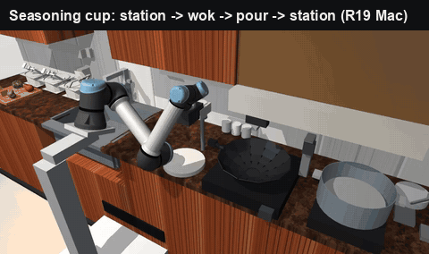 **Seasoning cup: station → wok → pour → back (R19, Mac)** One continuous checked path, 20.6 s, 2.2 mm reserve, 0 hits on a full re-check. The station pad moves 10 cm left. | 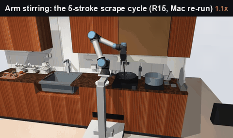 **Stir cycle with the arm (R15/R18, states stored on the Mac)** 5 scrape strokes, cart parked at x 0.55, 2.0 mm reserve, 25.8 mm plume clearance (#3). |
| 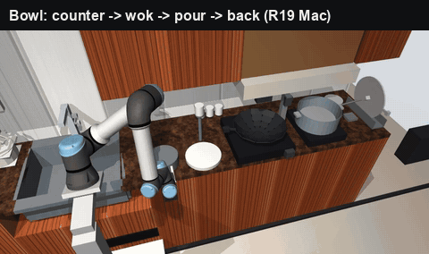 **Bowl pour: counter → wok → pour → back (R19, Mac)** 25.8 s, 1.9 mm reserve, 300 g of tomato or the holding bowl; 272 states re-checked, 0 hits. | |

### Physics benches, no arm

What the food, the door or the drum does, tested without the arm.

| | |
|---|---|
| 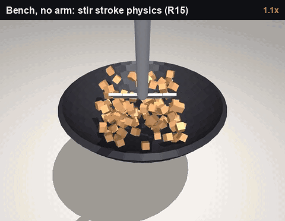 **Stir stroke physics (R15)** Free spatula on a compliant joint, 90 rigid dice; mixing measured. The arm cycle is checked separately (no clip yet, #3). | 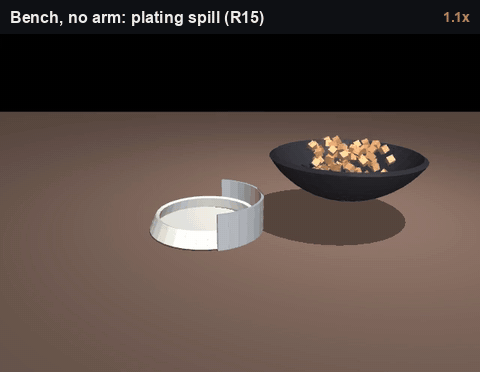 **Plating spill (R15)** 81–91 % of rigid dice on the plate (98 % at half load). The arm motion is the wok clip above. |
| 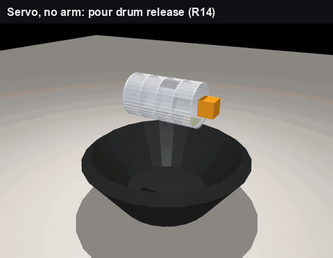 **Pour drum release (R14)** No arm by design: a servo turns the drum. Granules 100 % in order; liquids not simulated. | 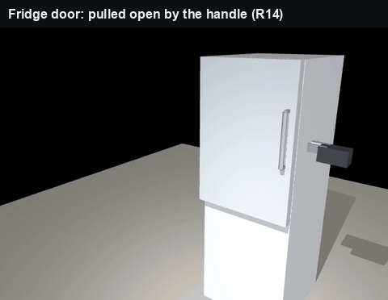 **Fridge door force (R14)** 100 N seal, 14 kg door: the pull the arm must make. |
| 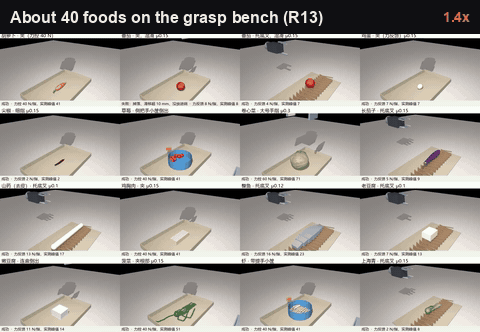 **About 40 foods (R13)** 702 rigid + 53 non-rigid runs, free-floating gripper; one grasp method per food. 1.4× |   |

Not rendered yet: the R19 hub roadmap.

## Open items
- **No real-food tests yet:**
  - stir quality with soft, oily and leafy food;
  - plating with sauce;
  - wet pad friction (a tilt test, which decides pinch or fork for about 10 foods);
  - the tomato wedging force and other unsourced process forces.
- **The user's real kitchen:**
  - it is L-shaped, and the sink is on the other leg from the hob;
  - the sim uses standard estimates (`inputs/user_kitchen/estimate.md`);
  - measurements are needed, including the real faucet.
- **Free moves between checked actions are estimates:** cart |dx| / 0.25 m/s + 1 s + 1.6 s, not collision checked.
- **Not checked:** one-arm scrubbing, kettle pours, 勾芡 by camera, fire-suppression placement, the drum holder's final place.
- **Purchases:** none. Prices are unconfirmed. Buying is the user's decision.

## History of concepts (R01–R18)
- **R01–R05**: rail-mounted arms in the user's galley kitchen (back wall, portal frame). The full meal never connected (0/156).
  - Rules settled here: the home safety tier, the arm torque envelope, contact windows, path checking.
- **R06**: a dedicated robot prep workstation (paused).
- **R07–R08**: an under-cabinet rail in the existing kitchen. The band was too tight for a 5 kg-class arm (sub-mm failures).
- **R09–R10**: the **tethered small-range cart** (user's idea). R10 removed the ballast (132 → about 65 kg) and docked the cart against the cabinets.
- **R11**: market tool set; a MuJoCo 3.2.5 box-box distance bug was worked around with box meshes.
- **R12–R13**: finger and hand design; every ingredient.
- **R14**: staples, seasonings, fridge.
- **R15**: cooking (heat, stir, additions, plating).
- **R16**: home-style meals, second heat zone.
- **R17**: faucet and sink rinse.
- **R18**: second plating spot, spatula home.
- **R19**: money and smooth motion.
  - Parallel studies: arm and hand cost, system cost, a movement library with hubs, smooth retiming, the hub roadmap, auto-stir products, seasoning sizing, a prep audit.
  - Corrections recorded:
    - stored paths contain 2π joint jumps (unwrap them before export);
    - R17 stepped coarser than the ≤ 4 mm rule (now re-checked);
    - R17 times assumed unlimited acceleration;
    - the stir period has velocity jumps.
  - See `sim/r10/claude/README_R10.md` (R19) and `research/r19_*.md`.

R01–R09 were run as a multi-agent board: Codex role agents plus a reviewer. Their prompts are in `prompts/`, their posts in `posts/`, and their scripts and reports in `sim/r01…r09`. From R10 on, the work is in `sim/r10/claude`.

## Lessons (method)
- **Per-pose IK success is not a followable motion.** Chain the candidates by IK continuation (contact phases) and joint-space moves (free phases), then check the whole path. Independent poses needed 250–1600 °/s joint jumps.
- **In MuJoCo 3.2.5, box-vs-box distances inside the margin are 0.5× the true gap.** Model the tool side as box meshes.
- **Run grasp physics with noslip.** Soft-contact creep made fingers look worse than they are.
- **Grasp sense ±1 is the tool turned 180° about the approach axis.** Flipping the object on its rest gives the other sense with the same gripper pose.
- **Screen fixture spots by replaying the saved checked paths**, then run the full chain for each kept spot. Don't claim "nothing works" before every kept row is run.
- **Never tune a process force to pass.** Report the arm's available force and what must be measured.

## Repository map
| Path | What |
|---|---|
| `DECISIONS.md` | Every user decision and design decision, dated (binding). |
| `sim/r10/claude/README_R10.md` | The detailed sim log R10–R18: layouts, results tables, failures and the changes they caused. |
| `research/` | Recipe analysis, market research (Taobao etc.), finger/hand options, the food catalog, storage and cooking markets. |
| `inputs/` | The user's kitchen photos and dimension estimates, cooking references, early checker inputs. |
| `prompts/`, `posts/` | The R01–R09 multi-agent board: prompts and round posts (reports and reviews). |
| `sim/r01`…`sim/r09` | Scripts and docs of the earlier rounds (bulky outputs and vendored code left out). |
| `sim/r10/claude/*.py` | The current sim: see below. |
| `sim/r10/claude/results/` | Result JSONs, including the full checked chains (per-run dynamics outputs, frame arrays and scene dumps left out). |
| `sim/r10/claude/renders/` | Overview images and videos. |
| `sim/r10/claude/cad/` | Printable finger, pad and mould parts (STEP/STL). |

**Current sim, main entry points** (in `sim/r10/claude`):
- `scene.py`, `checker.py`, `solver.py` (96-start collision-aware IK), `distance.py`: the scene and the unchanged checker.
- `kitchen14.py` … `kitchen17.py`: the kitchen layers per round.
- `chain.py`: the R11/R12 prep chains.
- `r17chain.py`: whole-action chains (keyframes, anchors, meet joins, cart modes).
  - `ACT=wok|lever|spider|lid|spatula`.
  - Spatula options `SPATREST`, `SPATELEV`, `SPATYAW`, `SPATROLL`.
- `r15stirwalk2.py`: the stir cycle; `SCENE=r17` runs it in the current kitchen.
- `r18spatscan.py`, `r18spatreplay.py`: rest screening by replaying checked paths.
- `r17seq.py`: action times → `results/r18/arm18.json`.
- `meal16.py`: one-arm meal schedule (`ARM=checked|r17|r18`).
- `foodbench.py`, `softbench.py`, `dyn.py`, `stirbench.py`, `pourwok.py`: physics benches.

**Running:**
- Python with MuJoCo 3.2.5, mink, numpy and scipy, run from `sim/r10/claude`. The sim used the venv in `robot_v5/board/work/t01/.venv` on the dev machine.
- The CAD scripts use build123d (conda env `robocasa`).
- **Not included:** the food mesh library (`assets/foods/`, 138 MB), vendored third-party code (RoboCasa, robot descriptions, PDF tools), logs, backups and multi-GB intermediate outputs. They stay in the local `robot_rail` folder. Scripts that need them (e.g. the food benches) won't run from this repo alone.

Snapshot taken from the local `robot_rail` folder on 2026-10-12.
