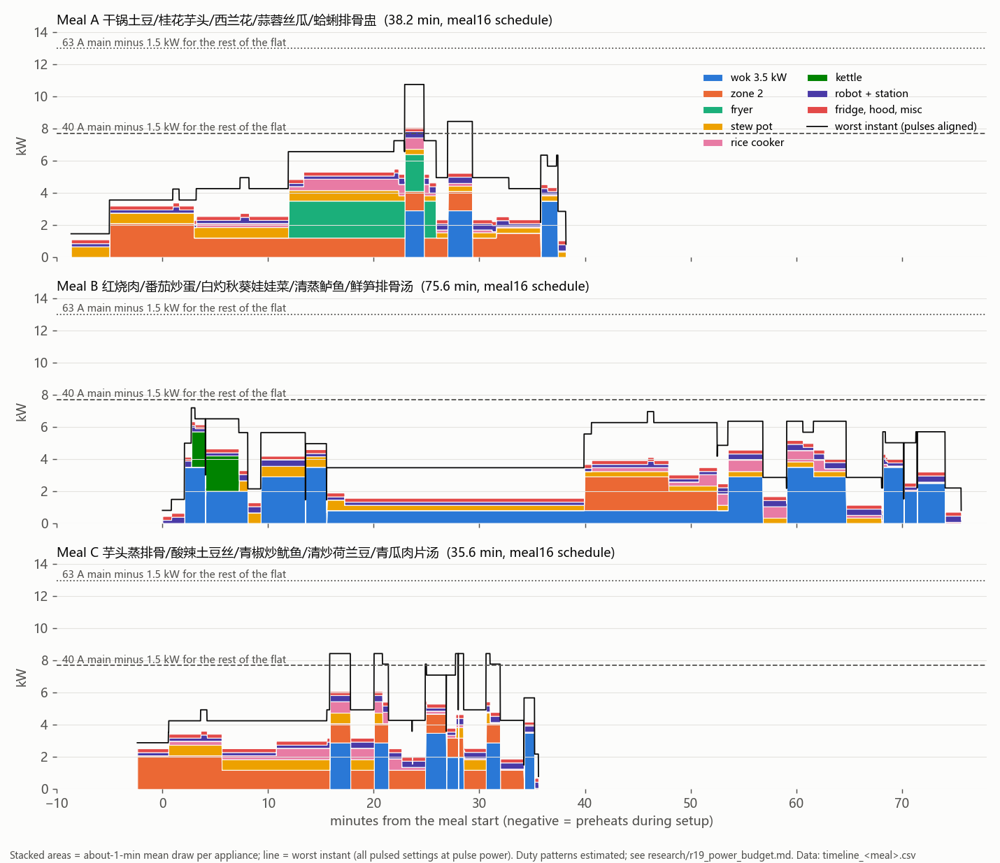

# R19: power budget per meal vs Singapore kitchen circuits (GitHub #17)

Date: 2026-10-13. Desk study: project files, plus WebSearch/WebFetch (read-only). No purchasing, no logins, no supplier or authority contact. No existing file was changed.

**New files**
- Model: `sim/r10/claude/r19power.py`.
- Outputs: `sim/r10/claude/results/r19/power/`:
  - `r19power.json`: everything below;
  - `timeline_A|B|C.csv`: 1 s, W per appliance;
  - `timeline.png`;
  - `bg0/`, `bg3000/`: the same run for another load in the rest of the flat.

**Labels**
- **[M]**: a manufacturer datasheet, an official page, or the official document.
- **[O]**: anything else: a retailer or marketplace listing, a news item, a forum, or a search-result snippet I could not open in full.
- **[E]**: my estimate or derivation.

Source keys such as [S1] point to the list at the end.

**Schedule**
- The schedule is `meal16.py SET=stew ARM=r18 USERRICE=1` (`results/r16/meal_stew_r18_userrice.json`), with these meal times:
  - A: 38.2 min;
  - B: 75.6 min;
  - C: 35.6 min.
- `r19power.py` runs meal16's own step lists and scheduler. It executes `meal16.py` only up to its output section.
- Without a cap, it reproduces the saved JSON step for step (asserted).

---

## 0. Bottom line

1. **The meals cannot run as the repo assumes today.** Today's plan is one new 20 A wok point, with everything else at the two existing outlets.
   - With one shared 20 A kitchen circuit, meal A loads it with a 15-min mean of 22 A and 1-min means up to 24 A. With pulses aligned, it reaches 32 A.
   - Two outlets also cannot host five heaters. One 13 A outlet or adaptor takes only one of zone 2, the fryer and the kettle (9.4–10 A each).
2. **One more new 20 A radial fixes the final circuits for every meal, with no delay.** This is plan P1: a new 20 A circuit for the wok, a second new 20 A circuit for zone 2 + fryer, and the rest on the existing kitchen circuit.
   - It is the issue's "2 new circuits, one RCBO each".
   - Every circuit stays ≤ its rating even with pulses aligned. Worst case: 19.4 A on the zone 2 + fryer circuit in meal A.
   - A third new circuit (P2) adds margin only. It saves no time.
3. **The binding limit is the flat's main switch, not the kitchen circuits.**
   - HDB flats from 1994 on (or upgraded) have 40 A [S2][S3]. That is about 9.2 kW for the whole flat.
   - With an assumed 1.5 kW running elsewhere (aircon, lights; [E]), meal A reaches a 1-min mean of 42.7 A for about 2 min. With pulses aligned it reaches 55 A.
   - B (39 A) and C (45 A with pulses aligned, 34 A mean) are borderline.
   - With 3 kW elsewhere (for example a water heater or a second aircon), all three meals go over 40 A.
4. **Cost of a power cap (start delays only, 40 A main, P1 circuits):**

   | Load in the rest of the flat | 1-min-mean cap (what heats a breaker) | Worst-instant cap (pulses aligned) |
   |---|---|---|
   | 0 kW | A/B/C **+0 / +0 / +0 min** | +0 / +0 / +0 |
   | 1.5 kW [E, default] | **+0 / +0 / +0** (the fryer starts 3 min earlier) | **+8.7 / +0 / +13.5** |
   | 3.0 kW | **+0 / +0 / +0** | +21.9 / +28.8 / +13.5 |

   - On P0 (no second circuit), meal A grows **+13.1 min** even on the mean cap, because of the 20 A kitchen circuit.
   - With a 63 A main, P1 needs no cap at all.
5. **Is a power-aware scheduler needed in the controller? Yes, a small one.**
   - **Static per-circuit budgets.** With the circuits right, coordinating start times costs nothing in the mean view (row 2 of the table).
   - **A live reading of the main current** (a CT-clamp meter at the board). The rest of the flat (aircon, water heater, washer) is unknown and changes; only a measurement covers it.
   - **Shedding priorities.** First the hold loads (stew pot, rice simmer, zone-2 steam hold) for a minute. Never the wok mid-stir, never the fryer during a fry.
   - Without coordination, the 40 A main sits at or above its rating for minutes in meal A, and for seconds in C.
6. **LEW work (likely):**
   - 2 new 20 A radials, each with a 30 mA RCBO;
   - about 5 more 13 A socket outlets on the hob leg, plus one in the upper cabinet for the seasoning station;
   - a hard-wired or BS 4343 connection for the 3.5 kW cooker (its China plug is not for SG);
   - a leakage test with every load running;
   - possibly a load upgrade application, or the controller cap above.
   - Details in §4.

**Open: check before buying the 3.5 kW cooker.**
- A search snippet of HDB's older electrical-works page says owners "are not allowed to install appliances with an electrical rating exceeding 15amps" [S3, O].
- The 3.5 kW cooker draws 15.2 A at 230 V.
- The current HDB page I could read only says that flats **without** higher loading need a permit for new 15 A points [S2, M].
- An LEW / HDB must confirm whether this applies to the user's flat. **Fallback:** a 3.0 kW unit (about 13 A at 230 V, right at the plug limit). It puts about 2.5 kW into the wok instead of about 2.9 kW (r15 §heat).

---

## 1. Loads

Values at Singapore's 230 V ±6 % [S1].

China-rated resistive heaters (220 V) draw (230/220)² = 1.09× their nameplate at 230 V. Induction units regulate their power, so they are taken at their rating.

| Appliance (design role) | Rated | Model / basis | Duty used in the model (all [E]) | PF | Inrush | After a power cut [E] |
|---|---|---|---|---|---|---|
| Wok: concave induction | **3500 W, 15.7 A** | 美的 MC-E35D2, 3500 W, 10 levels [r15; O smzdm] | Stir: 2.9 kW mean (heat policy: half power whenever the spatula stops, idle 36 % of the stir window), 3.5 kW peak. Boil-up of 1 L tap water: 3.5 kW for 120 s. Rolling boil: 2.0 kW mean. Braise: 0.8 kW mean, pulsed at 2.0 kW. Plating / sink / tap trips: 0. | 0.97 | soft start (est.) | Standby; restart needs the servo knob turned again. Fail-safe. |
| Zone 2: flat induction (MIoT) | **2100 W, 9.4 A** | 米家电磁炉2 2100 W [r15, M miot-spec]. The BOM's 米家电磁炉 N1 is also 2100 W [O ithome] | Preheat about 2 L steaming water: 6 min at full power. After loading: 2 min full, then steam 1.2 kW mean / 2.1 kW peak. Swap (luffa): 1.5 kW. | 0.97 | soft start | Standby; MIoT can read the state. |
| Electric water-bath stew pot | **656 W, 2.9 A** (600 W at 220 V) | Class estimate: a 1.2 L Tonze 隔水炖 unit is 300 W [O]. 4-cup units are not sourced | Full power while heating up (meal A bath: 16 min before the cups; meal C soup water: 15 min; meal B: 10 min after the hot water). Then thermostat about 50 %. | 1.0 | none (resistive) | A mechanical knob unit resumes heating. |
| Rice cooker | **710 W, 3.1 A** (650 W at 220 V) | 米家电饭煲 C1 3 L (MDFBZ02ACM) 650 W [O listing]. Started by the user | 35 min cycle: soak 35 %, boil 100 %, simmer 25 %, rest 10 % (est. split 29/34/17/20 % of the time) | 1.0 | none | A microcomputer cooker resets to standby. The rice is then half cooked. |
| Fryer | **2300 W, 10.0 A** | Tefal Oleoclean Pro FR8040, 3.5 L [O galaxus / mediamarkt / mydealz] | Preheat 10 min at full power (3.5 L oil, 28 → 170 °C ≈ 0.97 MJ ≈ 8 min, plus thermostat lag). Full power during the 3 min fry. Off after the lift-out (smart plug). | 1.0 | none | Mechanical switch + thermostat, so it **resumes heating hot oil when power returns**. It needs a smart plug that powers up OFF. |
| Kettle | **2200 W, 9.6 A** | 1.7 L, Philips HD9350 class [O listing] | Meal B only, as a conservative case: the soup step still says "hot water into the pot", so 1.7 L is boiled in 4.5 min just before it. R17 says the kettle is not needed (pot water is put in at setup). | 1.0 | none | Depends on the switch latch (est.). |
| Robot | **984 W peak**, 4.5 A | UR5e: 200 W typical / 570 W max [M datasheet]. IPC + sensors 60 W, gripper 24 W, drive supply 270 W [hardware.py allowances]. Brake coils 40 W and safety sensors 20 W [E]. Controller off-board, same feed | Idle 180 W mean / 300 W peak. With the arm moving: +190 W mean / +684 W peak | 0.95 | UR AC controller inrush not published. The OEM DC box is up to 400 A [S20] | Brakes engage. Manual reset (DECISIONS 10-08). |
| Seasoning station | **150 W** (24 V PSU) | [E] Doses during prep (`r19_seasoning_cups.md`): 15 W during the meal, 150 W peak kept as margin | — | 0.9 | PSU inrush (ms) | MCU resets. |
| Fridge (user's) | **150 W** running | [E] single door | 50 W mean | 0.7 | 5–8× for < 1 s (est.) | Restarts. |
| Hood (user's) | **160 W** | Slim hood class, Fujioh FR-SC2090: 85 / 125 / 160 W [O hkele] | On high the whole meal | 0.9 | — | Restarts. |
| Misc. | 30 W | Knob servo, stove guard, smart plugs, light [E] | constant | 0.9 | — | — |
| Rest of the flat (MAIN only) | **1.5 kW** [E] | One inverter aircon plus lights/TV at dinner. Sensitivity runs at 0 and 3 kW | constant | 0.95 | — | — |

**Two views of every load**
- **Mean:** about a 1-minute mean. Pulsed low settings count at their average. This is what heats a breaker's thermal element.
- **Peak:** the worst instant. Low induction settings pulse at a higher power, often 0.5–1 s on in a 3–5 s cycle ("burst mode") [S17][S18]. In the peak view every pulsed load is at its pulse power and all pulses are aligned. That is a conservative upper bound.

**Not in meal16, added here as preheats** (before the step; negative time = during prep and setup):
- the zone 2 water boil-up;
- the fryer oil;
- the stew-pot bath (meal A) and soup water (meal C);
- the kettle (meal B).

The meal clock assumes these can start up to 9 min before t = 0 (meal A: the stew pot from −8.7 min).

---

## 2. Power timeline per meal (meal16 schedule, no cap)

| Meal | Total | Kitchen peak (pulses aligned) | Kitchen 1-min max | Kitchen energy |
|---|---|---|---|---|
| A 干锅土豆 / 桂花芋头 / 西兰花 / 蒜蓉丝瓜 / 蛤蜊排骨盅 | 38.2 min | **10.7 kW** | 8.1 kW | 2.8 kWh |
| B 红烧肉 / 番茄炒蛋 / 白灼秋葵娃娃菜 / 清蒸鲈鱼 / 鲜笋排骨汤 | 75.6 min | 7.2 kW | 6.3 kW | 3.6 kWh |
| C 芋头蒸排骨 / 酸辣土豆丝 / 青椒炒鱿鱼 / 清炒荷兰豆 / 青瓜肉片汤 | 35.6 min | 8.4 kW | 6.1 kW | 2.1 kWh |

- Meal A's peak (minute 22.9–24.8) matches the issue's 9.5–10.3 kW estimate. At that point all of these overlap:
  - the 3 min fry;
  - the broccoli stir-fry;
  - the zone 2 steamer;
  - the stew pot;
  - the rice cooker at full boil;
  - the robot moving.
- The 10-min fryer preheat (minute 12–22) is the largest block nobody had counted.

**Per circuit: peak (pulses aligned) / 1-min max / 15-min max, in A.** Ratings: existing kitchen circuit assumed 20 A radial [E]; new circuits 20 A; main 40 A with 1.5 kW elsewhere.

| Plan | Circuit (rating) | Meal A | Meal B | Meal C |
|---|---|---|---|---|
| **P0** repo today | WOK new (20) | 15.7 / 15.7 / 5.3 | 15.7 / 15.7 / 10.6 | 15.7 / 15.7 / 6.3 |
| | KIT existing: zone 2, fryer, stew, rice, kettle, robot, station, fridge, hood (20) | **32.4 / 24.3 / 22.2** ✗ | 22.4 / 14.9 / 12.0 (peaks only) | 22.4 / 16.3 / 13.5 (peaks only) |
| **P1** +1 radial | WOK (20) | 15.7 / 15.7 / 5.3 | 15.7 / 15.7 / 10.6 | 15.7 / 15.7 / 6.3 |
| | NEW1: zone 2 + fryer (20) | 19.4 / 15.4 / 14.7 | 9.4 / 9.4 / 6.7 | 9.4 / 9.4 / 7.5 |
| | KIT: stew, rice, kettle, robot, station, fridge, hood (20) | 13.0 / 8.9 / 7.6 | 16.6 / 12.6 / 7.3 | 13.0 / 8.9 / 7.7 |
| **P2** +2 radials | NEW1: zone 2 + stew; NEW2: fryer + kettle; KIT: rice + small loads | ≤ 12.3 each | ≤ 12.3 each | ≤ 12.3 each |
| all | **MAIN (40)**, 1.5 kW elsewhere | **55.0 / 42.7 / 30.8** ✗ (110 s over on the 1-min mean) | 39.2 / 35.1 / 24.7 | **45.0** / 34.2 / 24.6 (peaks only) |

**Main 40 A against the rest of the flat (peak / 1-min / 15-min, A)**

| Elsewhere | A | B | C |
|---|---|---|---|
| 0 kW | 48.1 / 35.9 / 23.9 | 32.3 / 28.2 / 17.9 | 38.1 / 27.3 / 17.7 |
| 1.5 kW | 55.0 / **42.7** / 30.8 | 39.2 / 35.1 / 24.7 | 45.0 / 34.2 / 24.6 |
| 3.0 kW | 61.8 / **49.6** / 37.6 | 46.1 / **42.0** / 31.6 | 51.8 / **41.0** / 31.5 |

**How a breaker sees this.** IEC 60898-1 MCBs do not trip at 1.13 In within 1 h, and do trip at 1.45 In within 1 h. The instantaneous trip is 3–5 In (type B) [S12].
- So meal A on a 40 A main (1.07–1.24 In for about 2 min, pulses to 1.4–1.55 In) would **probably not trip**.
- It is still outside the design rule (load ≤ rating), with no margin left for a kettle or an iron switched on elsewhere.
- A trip mid-cook is the real hazard: the fryer resumes by itself (§1), and the robot stops with the wok hot.

---

## 3. Power-capped re-scheduling (`r19power.py`)

**Method**
- Every step carries its power profile, with its preheat.
- meal16's forward list scheduler places a step only at the earliest time when every circuit of the plan, MAIN included, stays ≤ its rating.
- The as-late-as-possible right-shift pass moves a step only as far as the cap allows. Otherwise it keeps the forward slot.
- Without a cap this is exactly meal16 (asserted).
- Delays only: no shedding and no power throttling. It is a greedy list scheduler, so not optimal, and a larger main can occasionally give a slightly longer greedy result (see P0).

**Meal growth in minutes, A / B / C** (1.5 kW elsewhere; `capped` in `r19power.json`, which also lists the moved steps)

| Plan | 40 A main, mean cap | 40 A main, peak cap | 63 A main, mean cap | 63 A main, peak cap |
|---|---|---|---|---|
| P0 repo today | **+13.1** / 0 / 0 | +20.1 / 0 / +22.1 | +13.1 / 0 / 0 | +19.5 / 0 / +14.1 |
| P1 +1 new radial | **0 / 0 / 0** | +8.7 / 0 / +13.5 | 0 / 0 / 0 | 0 / 0 / 0 |
| P2 +2 new radials | 0 / 0 / 0 | +8.7 / 0 / +13.5 | 0 / 0 / 0 | 0 / 0 / 0 |

**What moves**
- **P1, 40 A, mean cap:** in meal A the fry starts 3 min earlier, and the potato waits 3 min longer for the wok. Nothing else moves.
- **Peak cap, meal A:** the stew cups and the rice start about 9 min later. The fry moves to minute 27.6 and the broccoli to minute 36.
- **Peak cap, meal C:** the rice starts 14 min later and both quick stir-fries move behind the soup. Meal C ends at 49 min.
- **P0, mean cap, meal A:** the fry and the potato stir-fry are pushed to minute 43–47, because the 20 A kitchen circuit cannot carry the fryer preheat on top of the steamer, stew pot and rice.

**Sensitivity runs**
- **3 kW elsewhere** (`bg3000/`):
  - mean cap: still 0 / 0 / 0 for P1;
  - peak cap: +21.9 / +28.8 / +13.5 (meal B to 104 min, with dishes waiting up to 66 min).
- **0 kW elsewhere** (`bg0/`):
  - P1: 0 everywhere;
  - P0 is still bound by its kitchen circuit (meal A +13.1 mean, +19.5 peak; meal C +14.1 peak).

**Reading.**
- On the mean basis, P1 runs on a 40 A main at no time cost, even with 3 kW elsewhere. It only needs the scheduler to see the budget.
- The peak-cap costs (+9 to +29 min) are what you pay if the controller must guarantee the worst instant with no live measurement.
- Shedding a hold load (stew, rice simmer, steam hold) for the 1–3 min of a fry would remove most of that cost. Not modelled.

---

## 4. Singapore residential limits

| Item | Value | Source |
|---|---|---|
| LT supply | 230 V single-phase or 400 V three-phase, ±6 %. Single-phase "up to a maximum of 23 kVA, 100 A". PF basis 0.85. The incoming breaker "shall be set according to the approved load" | SP Group, *How to Apply for Electricity Connection*, Jan 2026, §1.2.1–1.2.3, §5.3.1 [S1, M] |
| Who applies | Extension or rewiring needs an LEW to apply for load connection (§1.5.2). A load upgrade at existing premises goes through the LEW (§2.1–2.3). In multi-metered premises, a tenant's upgrade is approved by the landlord / MCST or HDB, the master-metered consumer (§2.6) | [S1, M] |
| HDB main switch | Blocks completed on or after 1 Jan 1994, or upgraded under MUP/HIP: "higher electrical loading of 40amps main switch". Older blocks have 30 A | [S3, O: snippet of the HDB page]; [S4, O] |
| HDB permits | "Flats without higher electrical loading will require an HDB permit to install new 15amps power points for air-conditioners or other higher capacity equipment / appliances." | [S2, M] |
| HDB 15 A appliance rule | "You are not allowed to install appliances with an electrical rating exceeding 15amps power in your flat." **To confirm**; it affects the 15.2 A cooker | [S3, O: snippet only] |
| HDB 30 → 40 A programme | ELUP: about 1,500 older blocks raised from 30 A to 40 A, target 2030 | MND written answer [S5, O: snippet] |
| Upgrading above 40 A | Subject to approval and to spare capacity in the block's switch room. The LEW applies; about 8 working weeks; charged per added amp | [S6, O: secondary renovation sites]. Check the block with HDB's e-service [S7] |
| RCCB | From 1 Jul 2023, all domestic installations must have 30 mA RCCB protection on socket and lighting circuits. Existing homes by 1 Jul 2025; fine up to S$5,000 | EMA [S8, O: EMA page snippets] |
| Who may do the work | Only LEWs may carry out electrical work: rewiring, alterations, new points | EMA [S8]; HDB [S2] |
| Code | SS 638, Singapore's Code of Practice for Electrical Installations. It is BS 7671-derived: same radial and ring final circuits, 13 A BS 1363 socket outlets | CPSO [S9, M]. EMA's electrician test lists "13A SSO … in a final circuit with a 16A mcb", ring-circuit tests, and "HDB consumer unit receiving 40A 230Va.c." [S10, M] |
| Typical kitchen practice | 13 A switched socket outlets on 20 A radials (2.5 mm²) or 32 A rings. A 2-zone hob of about 3 kW gets "a dedicated MCB (straight from DB) 20A 4mm cable". A 7.2 kW 4-zone hob gets 32 A | [S11, O: retailer and forum, low quality]. Radial/ring sizes from BS 7671 practice [E] |
| Plug limit | 13 A per BS 1363 plug or adaptor, so ≤ about 3.0 kW per plug. One twin outlet or adaptor cannot carry two 2 kW heaters at once [E] | — |
| Leakage | Accumulated protective-conductor current downstream of an RCD ≤ 30 % of IΔn, i.e. ≤ 9 mA on a 30 mA RCCB (BS 7671 reg. 531.3.2; assumed to carry over to SS 638). Appliance limits (IEC 60335-1): 0.75 mA for portable class I; stationary heating 0.75 mA per kW, up to 5 mA | [S13, O]; [S14, O] |
| Condo | No source found for a typical unit rating. The developer sets each unit's load (SP §2.7.2). Read the DB's main switch [E: 40–63 A single-phase is common] | [S1] |

**What an LEW would need to do** (proposal; scope and price to be quoted after the survey, GitHub #11):
1. **Survey the board.** Record:
   - the main switch rating, and the HDB block loading (e-service) or the MCST approved load;
   - each MCB's rating and curve;
   - the RCCB(s) and which circuits they cover;
   - which circuit feeds each of the two kitchen outlets;
   - spare ways.
2. **New radial 1, wok:** 20 A MCB + 30 mA RCBO, about 4 mm², to a 20 A DP switch with a flex outlet (or a BS 4343 industrial socket) at the hob-leg corner. The China cooker's plug is replaced by a hard-wired connection.
3. **New radial 2, zone 2 + fryer:** 20 A + 30 mA RCBO, with 2 twin 13 A outlets at the hob leg (one heater per outlet).
4. **Existing kitchen circuit:**
   - 2–3 more 13 A outlets for the stew pot, rice cooker and kettle;
   - a 3 A fused spur in the upper cabinet for the seasoning-station PSU (no outlet there today);
   - the robot's tether stays on the sink-leg outlet. The reel's coiled rating is 1000 W against the robot's 984 W peak, so nothing else goes on the reel.
5. **Leakage test** with every load running (the issue's study step 4). An RCBO per new circuit keeps each RCD under its 9 mA budget. On one shared RCCB, the cooker (up to 2.6 mA at 0.75 mA/kW), the other heaters, the robot controller and the PSU filters (ND) can approach it.
6. **Main switch.** Either:
   - (a) keep 40 A and give the controller a CT-clamp meter on the incomer plus the budget below; or
   - (b) apply for a higher load (an LEW application; HDB / MCST approval; switch-room capacity; about 8 weeks [O]).
   - Option (a) is enough on the mean basis.
7. **Smart plugs** for the stew pot and fryer: 13 A rated, power-on state OFF.

---

## 5. Verdict and options

| Question | Answer |
|---|---|
| Can the meals run as scheduled on today's plan (P0)? | **No.** Meal A overloads the shared kitchen circuit (22 A for 15 min). B and C fit on the mean but peak at 22 A. Two outlets are physically too few. A cap would cost meal A 13 min (C up to 22 min on the peak view). |
| With which new circuits? | **P1:** the 20 A wok radial already planned, plus one 20 A radial for zone 2 + fryer, both on RCBOs, plus about 5 outlets. The meals then run exactly as scheduled on every final circuit. |
| What does capping cost on a 40 A main? | **0 min on the mean basis**, even with 3 kW elsewhere (meal A's fry moves 3 min earlier). On the worst-instant basis: +9 / 0 / +14 min at 1.5 kW elsewhere, up to +22 / +29 / +14 at 3 kW. With a 63 A main: 0. |
| Is a power-aware scheduler needed? | **Yes:** budgets per circuit and main, a live main-current input, and shedding priorities for the hold loads. Without it, meal A sits at 1.07–1.24× the 40 A main for about 2 min. That is unlikely to trip, but outside the rating, and a trip turns the fryer back on unattended. The model's mean-cap result shows the cost is near zero once the scheduler has the numbers. |
| Cheaper alternatives | (1) Drop the fryer (`r19_system_cost.md` O11): 2.3 kW and its 10-min preheat go. With the schedule otherwise unchanged, meal A's peak falls to 8.4 kW with pulses aligned (5.8 kW mean). The shallow-fry in the wok is not modelled. (2) A 3.0 kW cooker on a 13 A plug if the HDB 15 A rule applies. (3) If the existing kitchen circuit is a 32 A ring, P0's figures (A: 32.4 / 24.3 / 22.2 A) fit, and only outlets are needed. |

---

## 6. Gaps and honesty notes

- **Most numbers are estimates.**
  - Sourced: only the nameplates of the wok, zone 2, fryer, kettle, rice cooker, hood and UR5e.
  - Not sourced: the stew pot model, every duty pattern, the PFs, the preheat times, and the rest-of-flat load. All [E].
  - Not measured: no appliance was measured.
- **The concave cooker's low-setting behaviour is not documented.** That covers whether it pulses, and at what power. The 2.0 kW pulse is a guess; a clamp meter on the real unit settles it.
- **The circuit layout of the user's kitchen is unknown.** The existing kitchen circuit is assumed to be a 20 A radial, and the fridge and hood are assumed to be on it.
- **Meal model gaps carried over from meal16 (this study adds them only as power, not as time):**
  - the steamer, fryer and stew-pot preheats;
  - the kettle boil;
  - a 600 W water-bath stew pot needs about 16 min to bring its bath up, then cold cups go in. The "30 min" stew in meal A probably runs longer than modelled, or needs kettle water.
- **Not covered:**
  - prep machines (prep happens before the meal clock);
  - the fridge-door actions;
  - the washing machine, water heater and aircon beyond the single rest-of-flat number.
- **The capped scheduler only delays starts.**
  - It is greedy, so it is not optimal.
  - P0 is slightly longer with a 63 A main than with a 40 A main under the peak cap: a list-scheduling anomaly.
  - Shedding and throttling are not modelled.
- **HDB pages could not be read in full** (tables not rendered). The 15 A appliance rule, the 40 A rule and the upgrade process come from search snippets and secondary sites. An LEW must confirm them for the user's block.

---

## Sources

- [S1] SP Group, *How to Apply for Electricity Connection*, Jan 2026 (PDF, read in full): https://www.spgroup.com.sg/dam/jcr%3A66289889-80d2-4559-a479-a804d5323f19/How%20to%20Apply%20for%20Electricity%20Connection.pdf [M]
- [S2] HDB, Renovation guidelines: Electrical works: https://www.hdb.gov.sg/managing-my-home/renovation-and-maintenance/renovation/renovation-guidelines/electrical-works [M; the tables did not render]
- [S3] HDB, Electrical Works (older page; search snippets: the 40 A main switch from 1 Jan 1994 or MUP/HIP; the 15 A appliance rule): https://www.hdb.gov.sg/residential/living-in-an-hdb-flat/renovation/guidelines/electrical-works [O]
- [S4] Secondary: https://www.emergencyelectrician.sg/blog/hdb-electrical-loading/ (30 A ≈ 6.9 kW, 40 A ≈ 9.2 kW); https://www.homeanddecor.com.sg/renovation/hdb-electrical-loading [O]
- [S5] MND written answer on ELUP, 30 A → 40 A: https://www.mnd.gov.sg/newsroom/speeches/view/written-answer-by-ministry-of-national-development-on-upgrading-unit-electrical-power-supply-from-30a-to-40a-under-hdb's-electrical-load-upgrading-programme [O, snippet]
- [S6] Load-upgrade process (LEW, approval, about 8 weeks): search snippets of homeanddecor.com.sg / megafurniture.sg HDB electrical-loading articles [O]
- [S7] HDB e-service, electrical loading of a block: https://services2.hdb.gov.sg/webapp/BN31AWERRCMobile/BN31SElectrical?loadAction=electrical [O]
- [S8] EMA: https://ema.gov.sg/news-events/news/feature-stories/2023/electrical-safety-for-your-home-sweet-home and https://ema.gov.sg/consumer-information/electricity/electrical-safety (RCCB from 1 Jul 2023 / 1 Jul 2025, LEW only) [O: the pages render by script; snippets]
- [S9] CPSO, socket-outlet safety (SS 638 is the Code of Practice): https://www.consumerproductsafety.gov.sg/consumers/product-safety-tips/home-appliances-furniture-and-indoor-product-safety/safety-tips-on-universal-socket-outlets/ [M]
- [S10] EMA, typical technical questions for the electrician's licence, Ver. 02_2025_R1: https://elise.ema.gov.sg/eguides/TypicalTechnicalQuestions.pdf [M]
- [S11] https://megafurniture.sg/blogs/articles/best-induction-hob-singapore-cost-guide ; https://forum.lowyat.net/topic/5364314 [O, low quality]
- [S12] IEC 60898-1, 1.13 / 1.45 In and type B 3–5 In: https://resources.ipd.com.au/Flipbook/technical/files/basic-html/page4.html [O]
- [S13] BS 7671 reg. 531.3.2: https://www.test-meter.co.uk/blog/18th-edition-new-requirements-for-nuisance-rcd-tripping [O]
- [S14] IEC 60335-1 leakage limits: https://www.cosel.com/en/contact/product/faq/a0074.html [O]
- [S15] UR5e datasheet (200 W typical, 570 W max): https://www.universal-robots.com/media/1807465/ur5e_e-series_datasheets_web.pdf [M]
- [S16] Appliances [O]:
  - Tefal FR8040 2300 W: https://galaxus.at/en/s2/product/tefal-fr8040-oleoclean-pro-oil-fryer-deep-fryer-fryers-3228862 , https://www.mydealz.de/deals/tefal-fr-8040-oleoclean-pro-fritteuse-2300w-edelstahl-fur-7479eur-mediamarkt-mwst-aktion-2846340
  - 米家电磁炉 N1 2100 W: https://www.ithome.com/0/788/518.htm
  - 米家电饭煲 C1 650 W: https://othoba.com/xiaomi-mi-mijia-rice-cooker-non-stick-c1-3l-650w-mdfbz02acm-white-gimmick-bd-537589
  - Philips HD9350 2200 W: https://alta.ge/en/electric-kettle/philips-hd9350-90-1-7-l-capacity-2200w-p38469
  - Fujioh FR-SC2090 85 / 125 / 160 W: https://hkele.com.hk/en/FR-SC2090P-SM
  - Tonze 1.2 L stew pot 300 W: search snippet of best.pconline.com.cn guides
  - 美的 MC-E35D2: https://www.smzdm.com/p/179328503/ (and r15)
- [S17] Induction burst-mode low power: https://www.slw-ele.com/mastering-burst-mode-control-logic-in-induction-heating-systems.html [O]
- [S18] Patent CN108811212B (wave-dropping low-power heating): https://patents.google.com/patent/CN108811212B/en [O]
- [S19] Project files:
  - `sim/r10/claude/meal16.py`, `results/r16/meal_stew_r18_userrice.json`, `hardware.py`, `README_R10.md`;
  - `DECISIONS.md`;
  - `research/r14_storage_market.md`, `r15_cooking_market.md`, `r19_system_cost.md`, `r19_seasoning_sizing.md`, `r19_seasoning_cups.md`, `r19_arm_hand_cost.md`;
  - `inputs/user_kitchen/estimate.md`.
- [S20] UR OEM DC controller inrush (up to 400 A): `sim/r02/transport/results/power_addendum.md`, citing UR's OEM controller specification [M via project file].
